# Git

> 废话不多说，let's góoooo

## 1.下载

> [!TIP]
>
> 建议先创造一个Github账号
>

首先跳转[Git官网](https://git-scm.com/)（ctrl + 鼠标左键点击），下载Git

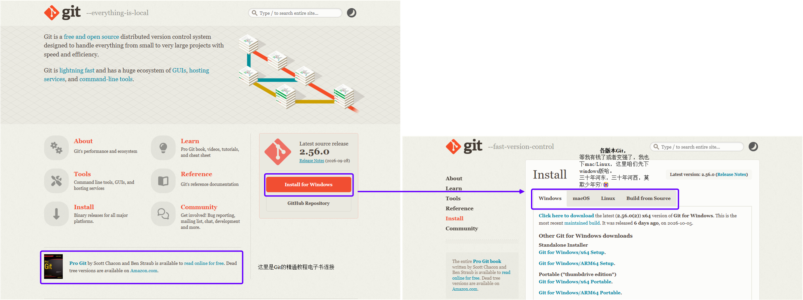

> 建议B站找一些参考的视频，因为下载的时候要注意下一些事项（视个人习惯，是一些快捷设置，懒人可忽略），基本就是以下几个：
>
> 1. Select Components页面
>
>    ​	我建议取消勾选`Windows Explore integration`，因为选这个会让你的右键多两个丑的快捷打开方式
>
> 2. Choosing the default editor used by Git
>
>    ​	这里建议选择`Use Visual Studio Code as Git's default editoir`，不过选择这个的前提是电脑上要提前下载Visual Studio Code
>
> 3. Adjusting the name of the initial branch in new repositories
>
>    ​	这里建议选`Override the default branch name for new repositories`

安装好Git后，还需要打开CMD，进行的一步配置就是

```cmd
git config --global user.name ''shannon''
git config --global user.email shen_ni@163.com
```

这里就是本地Git里的自报家门：你的名字和Email地址，此处要将`shannon`、`shen_ni@163.com`修改为你们自己的Github账号的名字和邮箱，不过名字可以随便改哈

> 如果没有配置，后面当你commit的时候就会显示：
>
> Make sure you configure your ''user.name'' and ''user.email'' in git.
>
> 这时候返回cmd或者powershell都可以，输入这两行命令即可
>
> 这里我设置的是自己的，家人们注意不要直接粘我的到你们CMD中，实在粘了，再次输入即可覆盖

------


## 2.创造本地Git Repository

假设我们创建了一个空文件夹`D:\项目\GithubProject\Guide`

然后打开Pycharm，在版本控制处选择创建Git仓库，在弹出的窗口返回选择Guide，就自动创建好了本地的Git Repository

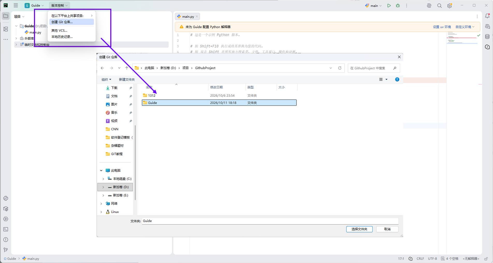

然后左上角版本控制就会出现Git的图案

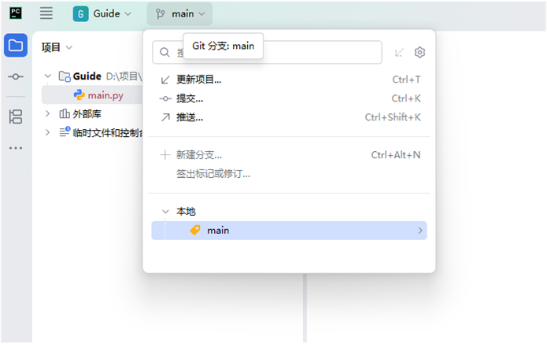

如果用命令行的话，要先进入在`D:\项目\GithubProject`中右键打开终端，然后

```cmd
mkdir Guide #创建空目录
cd Guide #转到这个子目录
pwd #这里是打印当前目录
git init #初始化空仓库，这个是核心的操作哦
```

可以看到，图形化GUI比命令行还是快多了吧​​​ :airplane:~

------


## 3.基础操作

这里建议先创建一个.gitignore文件，正好以.gitignore文件为案例

> 然后Pycharm会弹出一个界面，建议勾选不在询问，然后点击取消，这样虽然麻烦了点，但是可以避免一些失误
>
> 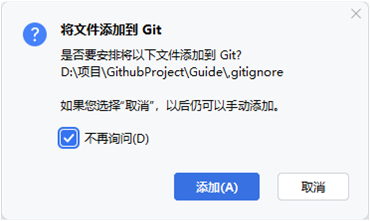
>
> .gitignore是用来忽略掉中一些比较私密的文件，在Git工作区的根目录下创建一个特殊的.gitignore文件，然后把要忽略的文件名填进去，Git就会自动忽略这些文件。(我才发现，我这个图里面打错了，打成了,gitignore，懒得改了)

------

### Add and Commit

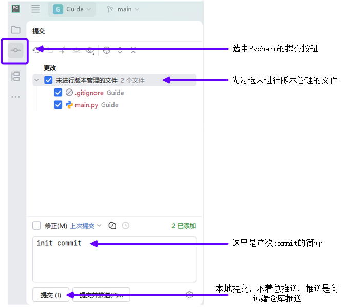

假设用命令行的话，

```cmd
git add .gitignore #暂存.gitignore
git add main.py #暂存main.py
# git add .gitignore main.py #同时暂存.gitignore main.py
git commit -m "init commit" #提交本次修改并添加简介
```

> 上方的是变更列表视角
>
> 提交这里还有第二个暂存区域视角
>
> 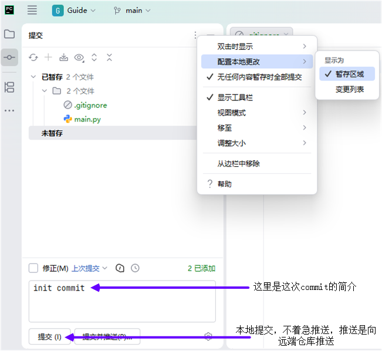
>
> 这个就是符合Git理念的暂存区域视角，先Add再Commit，咱们这种小黑作坊，直接变更列表不要太方便

------

最终，我们打开Pycharm自带的Git图形化界面，就可以看见init commit提交上去了


> 6分钟之前，请忽略哈，有时差是正常嘟，不是我不熟练:heart::heart::heart::anger:


### 远程Repository1

以简单上手的方式创建远程Repository需要在PycharmIDE中登录Github账号

> 也有其他方法，不过这种最简单啦

在设置中选择版本控制-->Github-->添加账户-->登录Github，之后会弹出一个授权浏览器界面，我这里之前浏览器有登陆过，所以直接授权了，如果你没登陆过，应该也不难，照提示做就行了-->此时Github账号就被记录到了IDE中，这样我们以后就拥有远程Repository修改的权限了，拥有了权限接下来就是创建你要用的Repository了

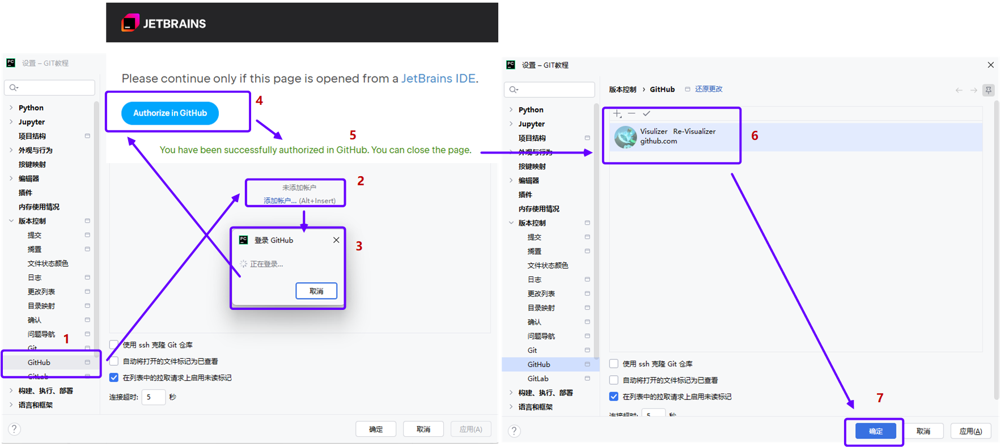

此时返回Github--> 创建新的Repository，按照下面的配置新的Repository初始化设置

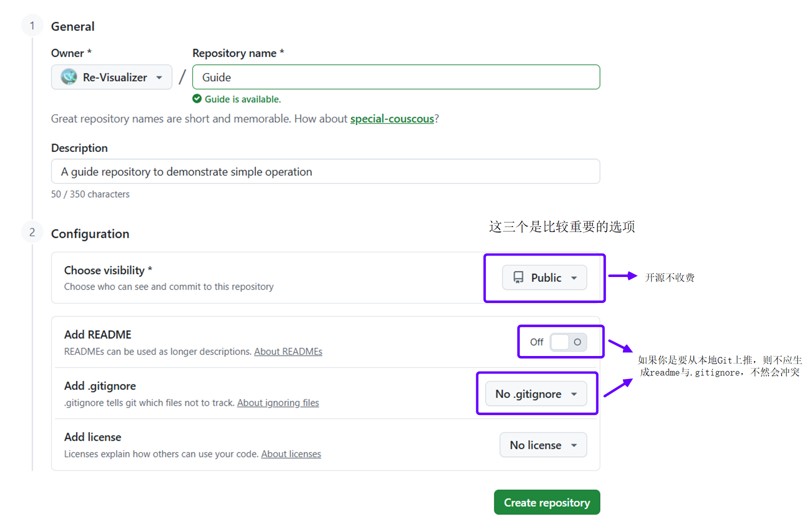

> 注意一定不要选择add readme or .gitignore

在完成Repository初始化后，

在Pycharm中选择推送

-->定义远程

-->将新Repository的HTTPS复制

-->然后输入到定义远程中的URL中

-->点击推送，即可完成远程部署

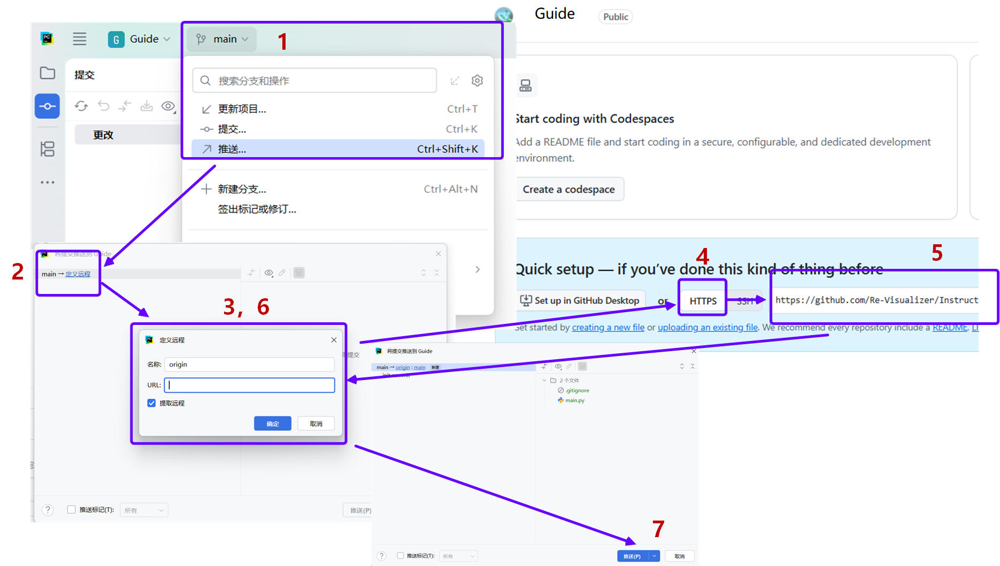

部署完成后我们查看一下远程Repository的变化，这样我们的远程Repository部署就完成了，大家后面就可以直接在Pycharm中直接commit和push了

```powershell
# 在手动创建远端Repository之后
git remote add origin https://github.com/Re-Visualizer/Graphical_Git_Instruction.git#绑定URL
# git remote add origin git@github.com: Visualizer/Guide.git #绑定URL
git push -u origin master #第一次push
```

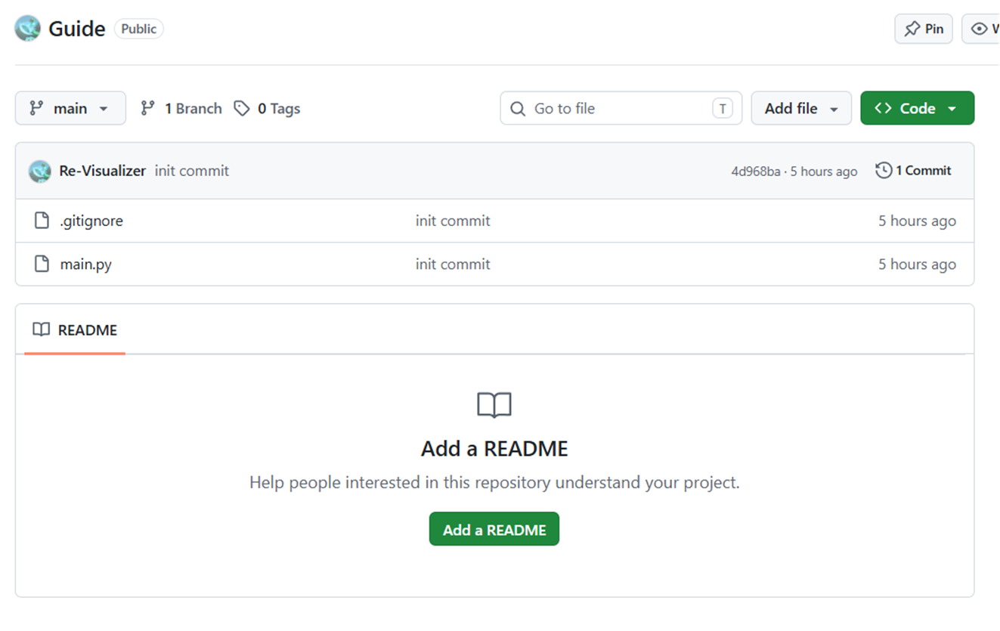

> 5小时对的哈，我有点人情世故要应对，所以不得不离开，脱离了科研第一线:innocent:

比如我们在.gitignore文件里面增加一个内容：`.vscode`，这样Git就会记录.gitignore进行了一次修改，于是Pycharm显示.gitignore变为蓝色，此时勾选更改、添加介绍：fixed .gitignore，然后提交并推送(Commit and Push)。

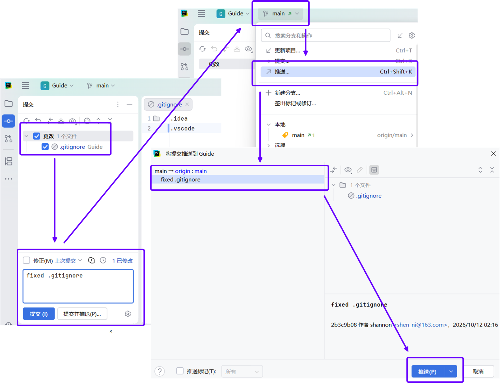

这样我们就完成了一次完整的提交与推送，然后我们再检查一下Pycharm中的Git日志与Github页面

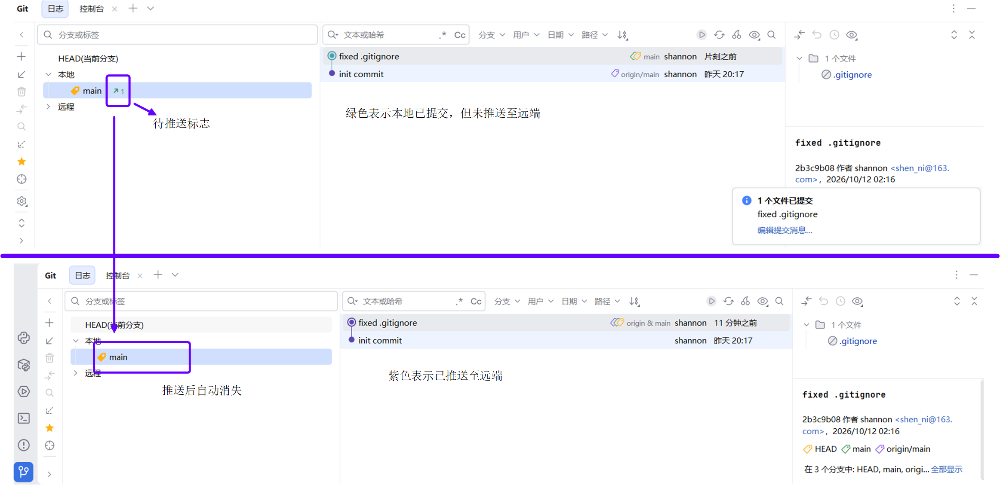

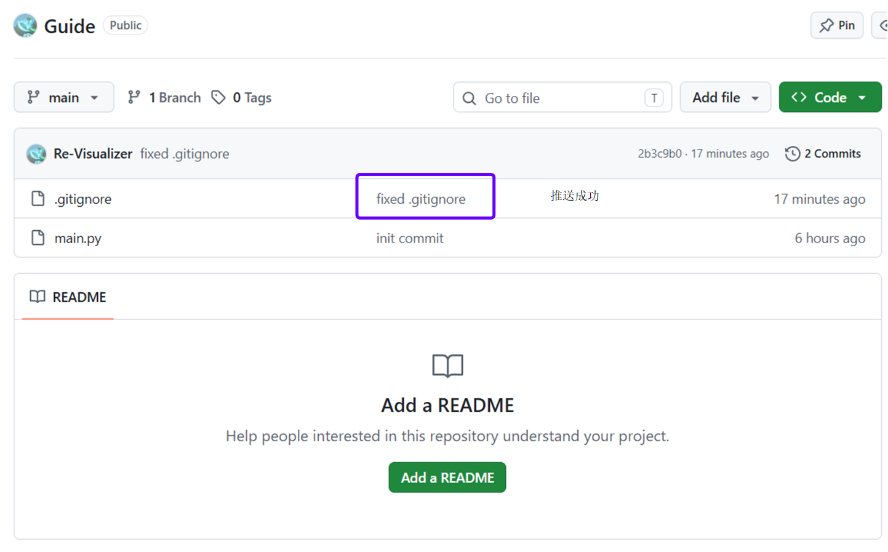

命令行操作：

```powershell
#在手动增加.gitignore内容之后
git add .gitignore #添加文件
git commit -m "fixed .gitignore"
git push origin master #以后push，注意跟第一次仓库的push指令不太一样，少了个参数
```

------

### 远程Repository2

本地Git Repository与远端Repository，有多种的建立交通的方式

之前，我们已经展示了一种：本地已有Git Repository传送到远端空Repository中 的方法

现在还有一种新的方法，适用于初始无本地Git Repository文件夹 + 无远端Repository

选择在以下平台上共享项目，然后选择Github，给仓库起名为2nd_github_Repository_method，然后将`未初始提交添加文件`默认的文件全部取消，这样就可以在远端创建一个可以从你本地Git中推送的空Repository

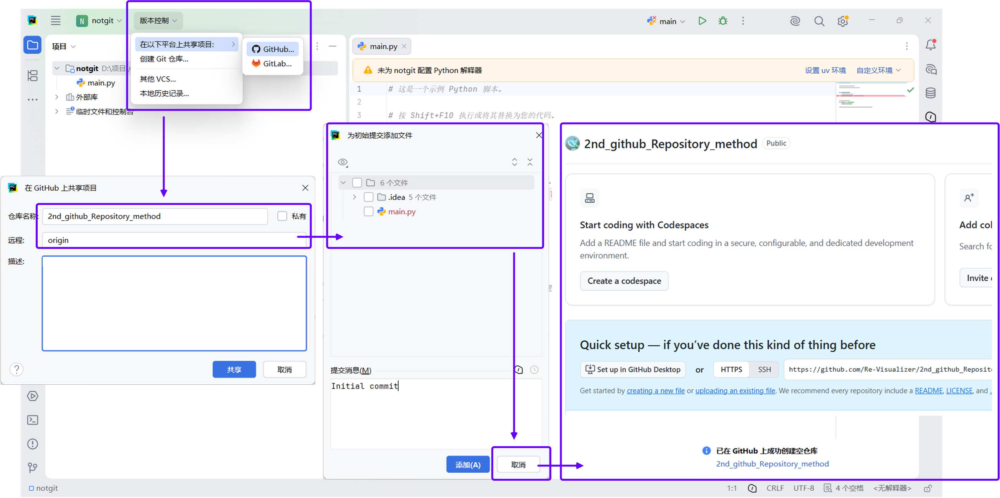

然后，我们开始给这个文件添加.gitignore并将其与main.py直接`提交并推送`到远端Repository，刷新Github页面，发现已成功init commit

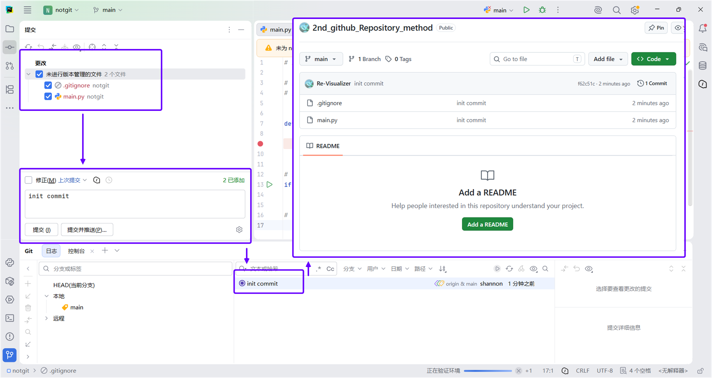

------

### 删除Repository

```powershell
Remove-Item .git -Recurse -Force #删除本地与远端的联系
```

删除掉Repository后，在Pycharm的设置-->版本控制-->目录映射 中删除对应映射即可

## 4.进阶操作


## 5.多电脑协作


## 6.Vscode

> 当你第一次用Visual Studio Code commit的时候，会弹出一个
>
> There are no staged changes to commit. 
>
> Would you like to stage all your changes and commit them directly? 
>
> 不想折腾的话直接选 `always` 即可 


# 爱上雷神

